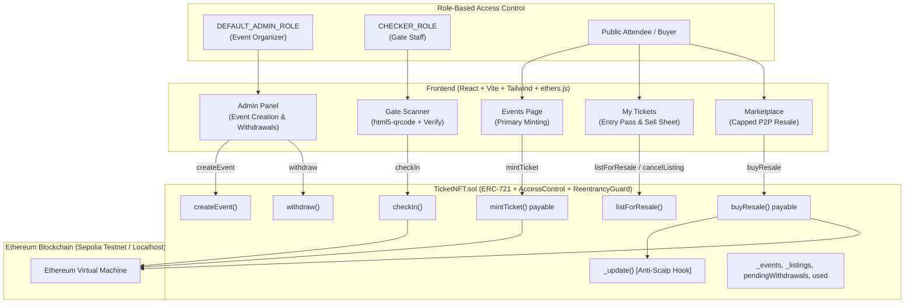

# 🎟️ Anti-Scalping NFT Ticketing DApp

A decentralized event ticketing protocol and mobile-first Web3 application powered by ERC-721 smart contracts on Ethereum. The protocol enforces immutable price caps, automated creator royalties, peer-to-peer transfer locks, and cryptographic anti-screenshot QR check-in credentials.

---

## 📌 Problem Statement

Traditional ticketing systems (Ticketmaster, AXS, StubHub) suffer from systemic industry problems:
1. **Predatory Secondary Scalping**: Automated bots hoard primary sales and resell tickets at 300%–1,000% markups on secondary exchanges.
2. **Fraud & Counterfeiting**: Static barcodes and QR codes are easily screenshotted, duplicated, and shared with multiple buyers, leaving legitimate fans locked outside venues.
3. **Zero Creator Royalties**: Event organizers, artists, and independent venues receive 0% of secondary market profits.
4. **Opaque Black-Market Transactions**: Off-platform trades leave buyers vulnerable to scams and invalid passes.

---

## 💡 Why Blockchain & Ethereum NFTs?

By representing tickets as on-chain **ERC-721 Non-Fungible Tokens** with custom transfer logic:
- **Mathematical Price Caps**: Secondary resale prices are capped in the smart contract (e.g. max 110% of face value). Higher asking prices revert at the EVM opcode level.
- **Direct Transfer Lock**: Peer-to-peer transfers are blocked unless executed through the audited on-contract marketplace.
- **Automated Pull-Payment Royalties**: Organizers receive an automatic royalty cut (e.g. 5%) on every resale.
- **Dynamic Cryptographic Passes**: Attendees generate a timestamped message signed by their private key (`personal_sign`) with a 120-second validity window, making static screenshot fraud impossible.

---

## 🏗️ Architecture



---

## 🛡️ Anti-Scalping & Resale Protocol Flow

```mermaid
sequenceDiagram
    autonumber
    actor Seller as Ticket Holder (Seller)
    actor Buyer as New Buyer
    participant App as DApp Frontend
    participant Contract as TicketNFT.sol
    participant Org as Organizer Balance

    Note over Seller,Contract: Direct wallet-to-wallet transfer blocked by _update() hook
    Seller->>App: Opens "Sell Ticket" Bottom Sheet
    App->>App: Calculates Cap = faceValue * maxResaleBps / 10000
    App-->>Seller: Restricts input (Red warning if > Cap, auto-clamp)
    Seller->>Contract: listForResale(tokenId, price <= Cap)
    Contract->>Contract: Store active listing; emit Listed()

    Buyer->>App: Browses Marketplace
    App-->>Buyer: Shows "+10% Over Face Value" (Guaranteed <= Cap)
    Buyer->>Contract: buyResale(tokenId) { value: price }
    Contract->>Contract: Verify buyer within maxPerWallet limit
    Contract->>Contract: Calculate Royalty = (price * royaltyBps) / 10000
    Contract->>Org: Credit Royalty via pendingWithdrawals
    Contract->>Seller: Credit (Price - Royalty) via pendingWithdrawals
    Contract->>Contract: Enable _inMarketplaceTransfer flag
    Contract->>Buyer: Transfer NFT ownership
    Contract->>Contract: Reset _inMarketplaceTransfer flag
    Contract-->>Buyer: Emit Resold(); Ticket ownership transferred!
```

---

## 📲 Cryptographic QR Check-in Protocol Flow

```mermaid
sequenceDiagram
    autonumber
    actor Attendee as Ticket Holder
    actor Checker as Gate Staff (CHECKER_ROLE)
    participant AttendeeApp as Attendee Mobile DApp
    participant Scanner as Gate Terminal (Scanner)
    participant Contract as TicketNFT.sol

    Attendee->>AttendeeApp: Taps "Show Entry Pass"
    AttendeeApp->>AttendeeApp: Construct message: TICKET-ENTRY|<contract>|<chainId>|<tokenId>|<ts>
    AttendeeApp->>Attendee: Prompt MetaMask personal_sign
    Attendee-->>AttendeeApp: Returns ECDSA signature
    AttendeeApp->>AttendeeApp: Encode payload: { t: tokenId, ts: timestamp, sig: signature }
    AttendeeApp-->>Attendee: Displays 280px QR + 120s Countdown Ring

    Checker->>Scanner: Points Rear Camera at QR (html5-qrcode)
    Scanner->>Scanner: Decodes payload { t, ts, sig }
    Scanner->>Scanner: Verify freshness: (now - ts) <= 120s and >= -10s
    Scanner->>Scanner: ethers.verifyMessage(msg, sig) -> recovers Signer Address
    Scanner->>Contract: Query ownerOf(t), used(t), ticketEvent(t)
    Contract-->>Scanner: Returns owner, used status, event active state
    Scanner->>Scanner: Verify Signer == owner && used == false && event active

    alt Pass is Valid
        Scanner-->>Checker: Displays Full-Screen Green "VALID TICKET"
        Checker->>Contract: checkIn(tokenId)
        Contract->>Contract: Set used[tokenId] = true; Cancel any listing
        Contract-->>Scanner: Emit CheckedIn()
        Scanner-->>Checker: Displays "ADMITTED 🎉" (auto-resumes in 2s)
    else Pass is Expired or Invalid
        Scanner-->>Checker: Displays Full-Screen Red "INVALID" with Exact Reason
    end
```

---

## 📜 Smart Contract Reference (`TicketNFT.sol`)

| Function | Visibility | Modifiers | Description |
| :--- | :--- | :--- | :--- |
| `createEvent(...)` | `external` | `onlyRole(DEFAULT_ADMIN_ROLE)` | Deploys a new event with price, supply cap, resale cap %, royalty %, and wallet limits. |
| `mintTicket(uint32 eventId)` | `external payable` | — | Purchases a primary ticket at face value. Revenue routes to organizer pull balance. |
| `listForResale(uint256 tokenId, uint256 price)` | `external` | — | Lists an owned ticket on the marketplace. Strictly enforces `price <= cap`. |
| `cancelListing(uint256 tokenId)` | `external` | — | Cancels an open marketplace listing. |
| `buyResale(uint256 tokenId)` | `external payable` | `nonReentrant` | Buys a listed ticket at asking price. Distributes royalty and transfers NFT. |
| `checkIn(uint256 tokenId)` | `external` | `onlyRole(CHECKER_ROLE)` | Burns/marks ticket as used at the door. Delists ticket from market. |
| `withdraw()` | `external` | `nonReentrant` | Pull-payment withdrawal of accumulated sales and royalty revenues. |
| `totalEvents()` | `external view` | — | Returns total count of events created. |
| `getEvent(uint32 eventId)` | `external view` | — | Returns the complete `Event` struct. |
| `totalMinted()` | `external view` | — | Returns total tokens minted across all events. |
| `walletBalance(uint32 eventId, address wallet)` | `external view` | — | Returns tickets held by a wallet for a specific event. |
| `isValid(uint256 tokenId)` | `external view` | — | Returns true if token exists and has not yet been checked in. |
| `getListing(uint256 tokenId)` | `external view` | — | Returns active resale listing parameters. |

---

## 🚀 Setup & Installation

### Prerequisites
- **Node.js**: v18.0.0 or higher
- **npm**: v9.0.0 or higher
- **MetaMask** browser extension or mobile app

---

### 1. Smart Contracts Setup

```bash
cd contracts
npm install

# Copy environment template
cp .env.example .env
```

Edit `contracts/.env`:
```env
SEPOLIA_RPC_URL="https://sepolia.infura.io/v3/YOUR_INFURA_KEY"
DEPLOYER_PRIVATE_KEY="0xYOUR_PRIVATE_KEY"
ETHERSCAN_API_KEY="YOUR_ETHERSCAN_KEY"
DEMO_ADDRESSES="0x123...,0x456..."
```

#### Compile & Test Contracts
```bash
# Compile contracts
npm run compile

# Run all 9 unit and security tests
npm run test
```

#### Deploy to Local Network or Sepolia
```bash
# Start local node in a separate terminal
npm run node

# Deploy locally
npm run deploy:local

# Deploy to Ethereum Sepolia Testnet (auto-verifies on Etherscan)
npm run deploy:sepolia
```

#### Seed Demo Events & Resale Listings
```bash
# Seeds 2 events, mints demo tickets, and lists one at the cap
npm run seed:local
# or for Sepolia:
npm run seed:sepolia
```

#### Grant Gate Staff Privileges
```bash
CHECKER_ADDRESS="0x..." npm run grant-checker:sepolia
```

---

### 2. Frontend Setup

```bash
cd ../frontend
npm install

# Copy environment template
cp .env.example .env
```

Edit `frontend/.env`:
```env
VITE_CONTRACT_ADDRESS="0x5DF5174Aa39c06b828F7e4e4B8d3fc0F12Abca5F"
VITE_RPC_URL="https://sepolia.infura.io/v3/YOUR_INFURA_KEY"
VITE_CHAIN_ID="11155111"
```

#### Run Frontend Locally
```bash
npm run dev
```
Open [http://localhost:5173](http://localhost:5173) in your browser or MetaMask mobile browser.

#### Build for Production
```bash
npm run build
```

---

## ⚙️ Environment Variables

### Contracts (`contracts/.env`)
| Variable | Description | Required |
| :--- | :--- | :---: |
| `SEPOLIA_RPC_URL` | HTTPS RPC endpoint for Ethereum Sepolia (Infura/Alchemy) | Yes (for Sepolia) |
| `DEPLOYER_PRIVATE_KEY` | Private key of the deployer / organizer wallet | Yes (for Sepolia) |
| `ETHERSCAN_API_KEY` | Etherscan API key for automated programmatic contract verification | Yes (for Sepolia) |
| `DEMO_ADDRESSES` | Comma-separated list of addresses for `seedDemo.ts` | Optional |

### Frontend (`frontend/.env`)
| Variable | Description | Required |
| :--- | :--- | :---: |
| `VITE_CONTRACT_ADDRESS` | Deployed `TicketNFT` contract address (defaults to compiled JSON) | Optional |
| `VITE_RPC_URL` | Fallback JSON-RPC endpoint for read-only contract calls | Optional |
| `VITE_CHAIN_ID` | Network chain ID (`11155111` for Sepolia, `31337` for Localhost) | Optional |

---

## 🧪 Automated Test Suite

The contract test suite (`contracts/test/TicketNFT.test.ts`) covers 9 comprehensive security and functional test suites:
1. **Event Creation**: `createEvent` allowed exclusively by `DEFAULT_ADMIN_ROLE`.
2. **Primary Minting**: Exact payment required; reverts on wrong price, sold-out supply, or exceeding per-wallet cap.
3. **Anti-Scalping Transfer Lock**: Reverts on direct peer-to-peer `transferFrom` and `safeTransferFrom`.
4. **Resale Cap Enforcement**: Listing at exactly the cap succeeds; 1 wei above reverts with `PriceAboveCap`.
5. **Secondary Purchase**: `buyResale` pays seller proceeds and organizer royalties trustlessly, updates ownership, and clears listing.
6. **Unauthorized Listing**: Non-owners cannot list tickets.
7. **Gate Validation**: `checkIn` callable exclusively by `CHECKER_ROLE`; double check-in reverts; used tickets cannot be listed.
8. **Pull Payment Withdrawals**: `withdraw()` transfers correct ETH balance and zeroes the claimable mapping.
9. **Reentrancy Protection**: Reentrancy attacks against `buyResale()` and `withdraw()` are blocked.

Run the tests:
```bash
cd contracts && npm test
```

---

## 📍 Deployed Contract Details

| Parameter | Value |
| :--- | :--- |
| **Network** | Ethereum Sepolia Testnet |
| **Chain ID** | `11155111` |
| **Contract Address** | [`0x5DF5174Aa39c06b828F7e4e4B8d3fc0F12Abca5F`](https://sepolia.etherscan.io/address/0x5DF5174Aa39c06b828F7e4e4B8d3fc0F12Abca5F) |
| **Etherscan Link** | [View on Sepolia Etherscan](https://sepolia.etherscan.io/address/0x5DF5174Aa39c06b828F7e4e4B8d3fc0F12Abca5F) |
| **Token Standard** | ERC-721 (Non-Fungible Token) with on-chain Base64 metadata |

---

## 🔒 Security Architecture

1. **ReentrancyGuard**: Applied to all state-changing external functions transferring ETH (`buyResale`, `withdraw`) following the Checks-Effects-Interactions (CEI) pattern.
2. **Pull-Payment Pattern**: Organizers and sellers accumulate ETH in `pendingWithdrawals[address]` and pull funds via `withdraw()`. Eliminates denial-of-service vulnerabilities inherent in push payments.
3. **Strict Access Control**: OpenZeppelin's `AccessControl` separates `DEFAULT_ADMIN_ROLE` (organizer) from `CHECKER_ROLE` (gate staff).
4. **Transfer Hook Override**: The internal ERC-721 `_update()` function blocks all non-zero to non-zero transfers unless the internal `_inMarketplaceTransfer` flag is explicitly asserted.
5. **Signature Replay Window**: Entry pass QR codes require a fresh signature signed within the last 120 seconds ($now - ts \le 120$), preventing replay attacks and static screenshot sharing.

---

## 🔮 Limitations & Future Work

- **Account Abstraction (ERC-4337)**: Implement sponsored gas/paymasters so fans without testnet ETH can mint tickets with credit cards or social logins.
- **Dynamic Seating & Tiered Tickets**: Add section, row, and seat-level tracking to the on-chain metadata.
- **Layer-2 Rollup Deployment**: Deploy to low-gas L2 networks such as Arbitrum, Optimism, or Base for sub-cent transaction fees.
- **Decentralized Media Storage**: Integrate IPFS / Arweave for rich media, posters, and musical artist collectibles associated with each NFT pass.

---

## 📄 License
MIT License. Created for advanced decentralized event ticketing on Ethereum.
